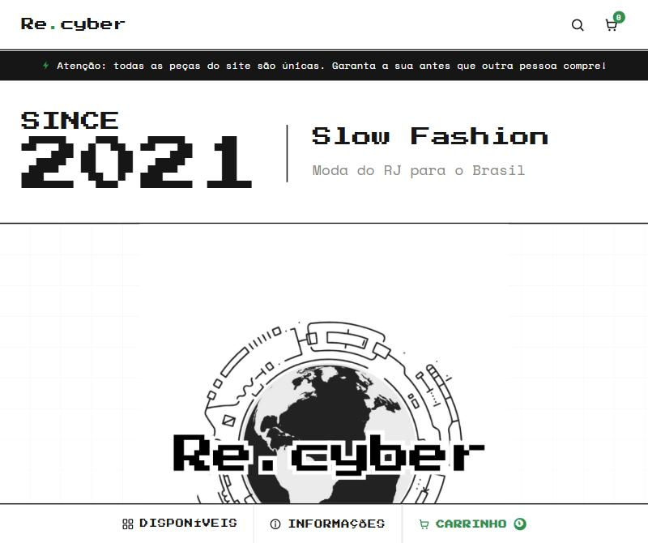
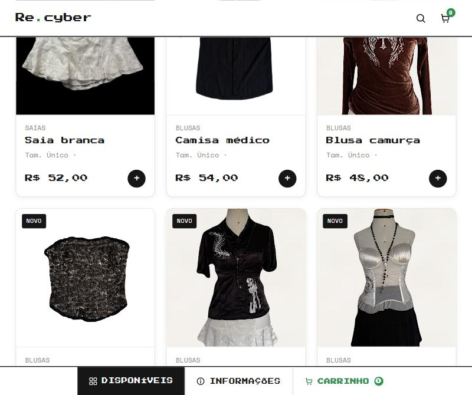

# Re.cyber: loja virtual de brechó

Loja virtual de brechó e moda slow fashion, com peças únicas vendidas direto pelo site. Todo o fluxo de compra é automatizado de ponta a ponta: catálogo, carrinho, pagamento, frete, etiqueta e notificações.

**🔗 Site no ar:** [recyber.com.br](https://recyber.com.br)

> Este repositório é só uma vitrine do projeto. O código-fonte é privado para proteger a loja e os dados dos clientes.

## O problema que resolve

Vender peças únicas de brechó sem depender de planilha manual ou de marketplace de terceiros. O dono cadastra a peça pelo painel (ou por automação, sem precisar entrar no painel), ela aparece na hora no catálogo, e a partir daí o site cuida sozinho do pagamento, do frete, da etiqueta, dos e-mails e do aviso de peça vendida.

## O que o site faz

### Para o cliente
- **Catálogo por categorias**, com tamanhos e medidas de cada peça.
- **Campanhas de desconto** ("Modo Promo") com contagem regressiva, cupom e frete grátis configurável.
- **Pagamento por Pix ou cartão** pela InfinitePay.
- **E-mails automáticos** a cada etapa do pedido: confirmação, pagamento aprovado e rastreio.
- **PWA:** pode ser instalado na tela inicial do celular.

### Para o dono (painel administrativo)
- Cadastro e edição de peças, com fotos, tamanhos, gênero e **publicação agendada**.
- Gestão de pedidos e clientes, com o pedido mudando para pago sozinho quando o pagamento é aprovado.
- **Etiqueta de frete automática** pela Melhor Envio: o sistema escolhe a transportadora mais barata e gera a etiqueta assim que o pagamento cai.
- Peça vendida sai do catálogo sozinha (é peça única).
- **Financeiro:** gastos do mês e relatório mensal por e-mail.
- **Métricas** de origem das visitas e lista de marketing (newsletter).
- Textos de e-mail e WhatsApp editáveis pelo próprio painel.
- **Feed de produtos** para Instagram Shopping, Meta Commerce Manager e TikTok Shop.

## Segurança
- **Preço, desconto e frete são recalculados no servidor.** O valor que aparece no navegador não decide o que é cobrado.
- O pedido só é marcado como pago depois de **conferir o pagamento direto com a InfinitePay** e checar se o valor bate com o pedido.
- Dados de clientes e pedidos protegidos por regras de acesso no banco (RLS): só o dono, depois de fazer login, consegue ver.
- Chaves de API e dados pessoais ficam em variáveis secretas do servidor, nunca no código.

## Tecnologias

| Camada | Tecnologia |
|---|---|
| Front-end | HTML, CSS e JavaScript puro (sem framework) |
| Backend / API | Cloudflare Workers |
| Banco de dados e login | Supabase (Postgres + Auth) |
| Fotos | Cloudflare R2 |
| Pagamentos | InfinitePay (Pix e cartão) |
| Frete | Melhor Envio |
| E-mail | Resend |
| Hospedagem | Cloudflare, com publicação automática a cada atualização |

---

Desenvolvido por [nandevil](https://github.com/nandevil).
